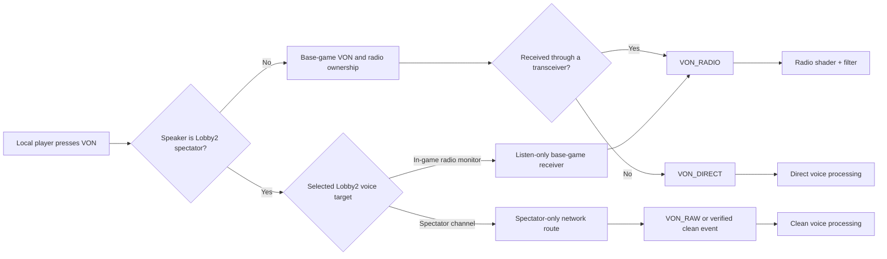

# Spectator VON audio routing

## Decision

The requested behavior should be represented as two different **playback classes**, not as one radio event whose filter is toggled by spectator mode:

| Traffic | Network recipients | Required VON playback event | ACP result |
| --- | --- | --- | --- |
| Spectator speaking to spectators | Spectators in the selected Lobby2 voice channel | `VON_RAW` if the engine route can produce it; otherwise a verified clean/direct event | Clean headset-style voice; no radio shader |
| In-game player transmitting over a radio | Receivers tuned to the authoritative base-game radio | `VON_RADIO` | Existing radio shader, radio noise, and radio filter chain |
| Ordinary nearby speech | Players in direct-speech range | `VON_DIRECT` | Existing positional direct-speech chain |

This preserves one `VoNComponent`. The unresolved part is not the ACP graph: it is whether Reforger exposes a supported transmission route that can deliver spectator-only traffic while causing the receiver to play `VON_RAW` (or another clean event).

An external audio variable is useful for a **listener-wide mode switch**, but is not a safe per-speaker/per-packet discriminator. The public scripting API sets an external variable by name and variable-config resource. That value is shared by the audio variable resource; the VON receive callback does not supply a per-playing-sound audio handle. Two simultaneous streams could therefore fight over one value:

- spectator A -> spectator listener: clean
- in-game radio operator -> same spectator listener: filtered

The same listener must be able to hear both at once, so a single global `SpectatorClean` variable cannot robustly select the branch.

## Current `{B4C3941EC8B2AD21}Sounds/VON/von.acp` graph

| Event | Immediate graph inputs | Effective route | Notes |
| --- | --- | --- | --- |
| `VON_RADIO` | `Shader Radio` and `Shader Direct` | Radio: `Bus Voice + Noise` -> radio `FilterChain`; direct: normal direct path | Keeps the filtered radio feed while retaining the normal direct component used by the vanilla graph. |
| `VON_DIRECT` | `Shader Direct` | `Bus Ducking When Many Voices` -> `Bus Direct Processing` | Positional/direct speech. |
| `VON_RAW` | `Shader RAW` | `Bus Direct Processing` | Bypasses the radio shader, noise generator, and aggressive radio chain. It still uses the common direct-processing bus, so "clean" means normal voice processing rather than literally zero DSP. |

The aggressive radio coloration is localized to the radio branch:

- bit crusher
- high-pass at 1200 Hz
- hard clipper
- low-pass at 3600 Hz
- generated Brownian noise

The common direct-processing path contains the milder voice chain (high-pass at 220 Hz, low-pass at 8000 Hz, low shelf, and compressor).

## Why ACP cannot identify a spectator by itself

The audio project receives named VON sound events and audio signals. The current project has no signal or variable carrying Lobby2 phase, spectator state, sender player ID, or source class. Consequently, duplicating a clean branch under `VON_RADIO` does not provide a reliable selector for that branch.

`VoNComponent.OnReceive` does expose useful routing metadata to script:

```text
sender player ID
whether the sender is an active editor
receiving transceiver (null for non-radio reception)
frequency
quality
```

This is sufficient to classify a received packet as radio versus non-radio at the gameplay layer, but the callback exposes no audio handle or per-instance ACP parameter. It therefore does not prove a safe way to bind an external variable to only that packet's playing sound.

## Recommended flow



The in-game radio remains base-game authoritative. Lobby2 may own only the spectator channel selection and access policy. A spectator joining an in-game channel should attach/listen through the base-game receiver path without copying faction, group, or radio ownership into a second system.

## Single-component implementation options

### Option A - distinct engine playback events (preferred)

Keep the character's existing `SCR_VoNComponent` and make transmission routing select the correct existing event class:

- spectator-only traffic -> raw/clean event
- actual transceiver reception -> radio event

This naturally supports simultaneous clean spectator speech and filtered in-game radio speech because each playing stream enters a different ACP sound node.

Before implementation, a live multiplayer spike must prove all of the following:

1. A supported communication method or routing surface can restrict clean traffic to the Lobby2 spectator recipients.
2. The receiver actually emits `VON_RAW` (or another identified clean event), rather than `VON_RADIO`.
3. A spectator can monitor a real in-game transceiver without changing the authoritative in-game player's channel membership.
4. Spectator transmission does not leak into an in-game radio channel while monitoring it.
5. Clean and filtered speakers can be heard concurrently on one spectator client.

### Option B - external variable (prototype/fallback only)

Create an add-on-owned audio-variable config with an `External` variable, drive it locally with `AudioSystem.SetVariableByName`, and use its curve to control clean/radio branch gains.

This is valid only if testing proves the variable is sampled and retained per VON sound instance. Current public declarations do not establish that behavior, and the resource-wide setter strongly suggests shared state. Do not ship this path if simultaneous received streams switch each other's processing, chatter, or briefly leak into the wrong branch.

Do not add a continuously updated global variable merely based on "local player is spectator." That would make **all** radio received by that spectator clean, including the in-game radio traffic that must remain filtered.

### Option C - multiple `VoNComponent` instances (rejected)

Multiple components can appear to separate graph state, but they create ambiguous capture ownership, duplicate receive/update paths, and lifecycle problems during possession and spectator transitions. This is not the canonical Lobby2 design unless engine testing proves there is no supported single-component route and the user explicitly revisits the tradeoff.

## Verification matrix

| Case | Expected recipients | Expected sound | Must not happen |
| --- | --- | --- | --- |
| Spectator A talks on spectator global | Spectators assigned to global | Clean | In-game players hear it; radio filter appears |
| Spectator A talks on personal spectator channel | Only authorized spectator members | Clean | Other spectators or players hear it |
| Player A transmits on squad radio | Tuned in-game receivers plus monitoring spectators | Filtered radio | Monitoring spectator hears a clean version |
| Player A speaks locally | Nearby in-game listeners | Direct/positional | Remote spectator channel receives it as global speech |
| Spectator and player transmit simultaneously | Correct recipients for both | One clean stream plus one filtered stream | External state makes both streams clean or both filtered |
| Spectator exits or game mode unloads | Nobody retains Lobby2 routing | Base behavior restored | Stale receiver, callback, audio variable, or subscription remains |

Multiplayer coverage must include dedicated server, listen host, owning spectator client, ordinary in-game client, non-member spectator, concurrent speech, JIP, possession changes, and game-mode teardown.

## Evidence

- Official Wiki, **Audio: Sound Events**, `VoNComponent` section, lines 113-120: the component publishes `VON_DIRECT`, `VON_RADIO`, and `VON_RAW` events.
- Official Wiki, **Audio Editor: Audio Variables**, lines 5-12 and 27-35: audio variables are resource-based; `External` values come from script/gamecode.
- Official Wiki, **Audio Editor: Audio Variables**, lines 68-90: `AudioSystem` owns the external-variable setters, and the filename is the full variable-config resource path.
- Indexed Game Data, `scripts/Game/generated/Components/VoNComponent.c`, lines 19-62: one component owns capture/playback; `SetCommMethod`, `SetTransmitRadio`, `OnCapture`, and `OnReceive` are the exposed VON surface.
- Indexed Game Data, `scripts/Game/generated/ECommMethod.c`, lines 7-29: the declared communication methods are direct, squad radio, AI direct, Game Master direct, and Game Master radio. There is no declared spectator method.
- Indexed Game Data, `scripts/GameCode/Network/SCR_VoNComponent.c`, lines 63-89: the vanilla subclass forwards capture and receive metadata to display/invoker code but does not expose a per-stream audio handle.
- Indexed Core Data, `scripts/Core/generated/Audio/AudioSystem.c`, line 84: `AudioSystem.SetVariableByName(string varName, float value, string resourceName)` is a static resource-addressed setter.

Official references:

- <https://community.bistudio.com/wiki/Arma_Reforger:Audio:_Sound_Events>
- <https://community.bistudio.com/wiki/Arma_Reforger:Audio_Editor:_Audio_Variables>
